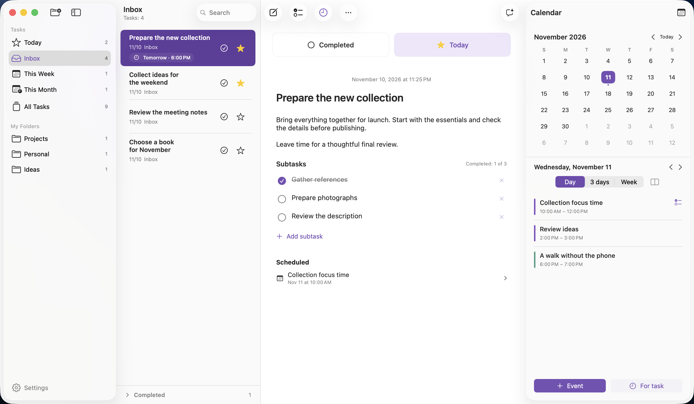
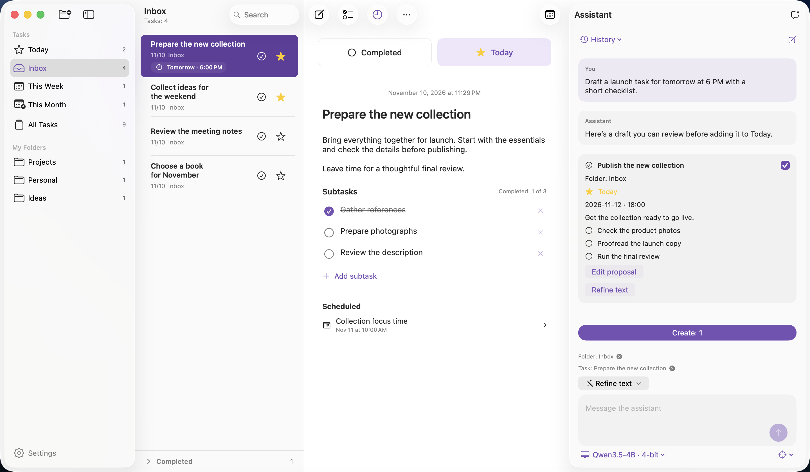
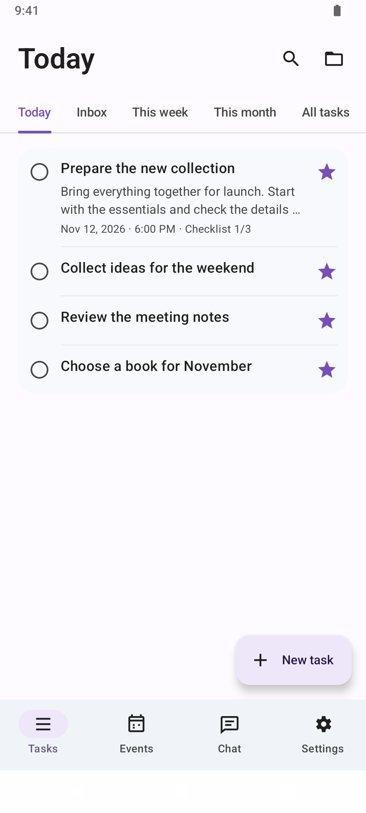
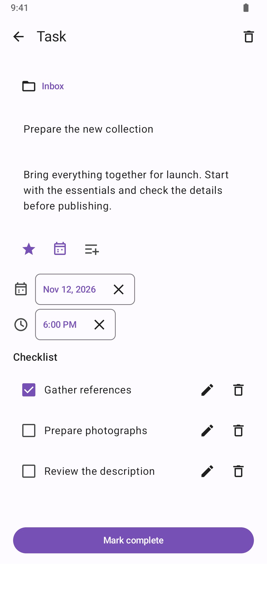
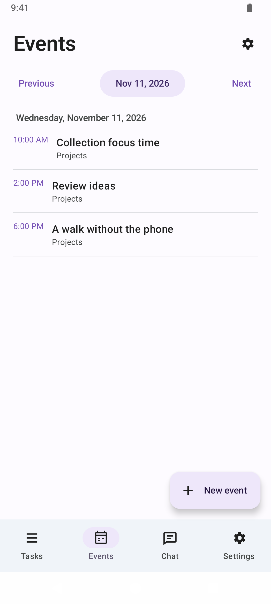
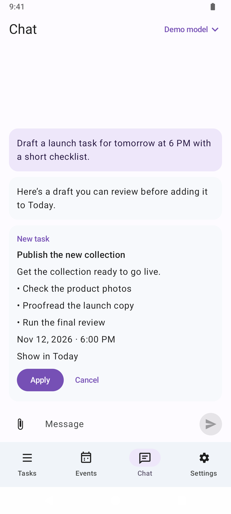

<p align="center">
  
</p>
<h1 align="center">Takt</h1>
<p align="center">Deine Aufgaben, die nächsten Schritte und Zeit dafür.</p>
<p align="center"><a href="README.md">English</a> · <a href="README.ru.md">Русский</a> · <strong>Deutsch</strong> · <a href="README.fr.md">Français</a></p>

<p align="center">
  <strong><a href="#installation">macOS</a></strong> 26+ · Apple Silicon
  &nbsp; | &nbsp;
  <strong><a href="#android">Android</a></strong> 8.0+ · Test-APK
</p>

Takt vereint Aufgaben, Tagesplanung und Kalender auf macOS und Android. Auf dem Mac kannst du deine Aufgaben ohne Konto auf dem Gerät speichern. Aktiviere die Cloud-Synchronisierung, um auf Android weiterzuarbeiten.

[Funktionen](#funktionen) · [KI-Chat auf macOS](#ki-chat-auf-macos) · [Erste Schritte](#erste-schritte-auf-macos) · [Aus dem Quellcode bauen](#aus-dem-quellcode-bauen)



*Screenshot der englischen Oberfläche mit erfundenen Beispieldaten.*

## Funktionen

- **Ordner.** Jede Aufgabe gehört zu einem Systemordner oder zu einem eigenen Ordner. „Today“ zeigt markierte Aufgaben. „All Tasks“ zeigt alle Aufgaben nach Erstellungsdatum.
- **Aufgaben verschieben.** Ziehe eine Aufgabe in einen Ordner in der Seitenleiste oder wähle „Move to Folder“ im Kontextmenü oder im Menü „…“. Beim Ziehen auf „Today“ erhält sie einen Stern und bleibt in ihrem Ordner.
- **Prioritäten.** Markierte Aufgaben bleiben in „Today“, bis du den Stern entfernst. Ihre Reihenfolge bleibt erhalten.
- **Beschreibungen und Teilaufgaben.** Schreibe Beschreibungen als Klartext mit automatischer Listenfortsetzung und verfolge den Fortschritt in einer Checkliste.
- **Fristen.** Lege ein Datum und bei Bedarf eine Uhrzeit fest. Die Frist ist unabhängig von Kalendereinträgen. Erinnerungen folgen Änderungen an der Frist und werden beim Abschließen oder Löschen der Aufgabe entfernt.
- **Tagesplanung prüfen.** Aktiviere „Time to review your tasks“ in den Einstellungen. Wähle eine Uhrzeit und beschränke die Erinnerung bei Bedarf auf Werktage. Sie ist standardmäßig ausgeschaltet.
- **Kalender in der Seitenleiste.** Die kompakte Monatsansicht wird durch eine Agenda für einen Tag, drei Tage oder eine Woche ergänzt. Die Agenda lässt sich vertikal oder horizontal anzeigen.
- **Zeit für Aufgaben.** Erstelle einzelne Termine oder plane mehrere Zeitblöcke für eine Aufgabe. Bearbeite beschreibbare Einzeltermine, verschiebe sie auf andere Tage und mache Verschiebungen rückgängig.
- **Suche.** Suche im aktuellen Bereich nach Aufgabentiteln und Beschreibungen.
- **Native macOS-Oberfläche.** Helle und dunkle Darstellung, transparente Seitenleisten, Tastenkürzel sowie eine englische und russische Oberfläche.

## KI-Chat auf macOS



*In diesem Beispiel entwirft der Assistent eine Aufgabe mit Checkliste. Du kannst sie prüfen und bearbeiten, bevor du sie zu „Today“ hinzufügst.*

## Installation

**macOS 26 oder neuer auf Apple Silicon.**

Quellcode-Version **0.2.17 (Build 67)** · [Versionsverlauf](docs/releases).

Lade ein DMG aus [**Releases**](https://github.com/Alex-De-Vep/takt-planner/releases) herunter. Öffne es, ziehe **Tasks** nach **Programme** und wirf das Image aus. Beende die App, bevor du eine frühere Version ersetzt.

Die App ist ad hoc signiert. Gatekeeper kann das Öffnen eines Downloads auf einem anderen Mac einschränken. In diesem Fall kannst du die App in Xcode selbst bauen.

## Android

Der Client läuft ab **Android 8.0**. Er bietet Aufgabenlisten, Teilaufgaben, Fristerinnerungen, einen Kalender und einen KI-Assistenten. Melde dich mit demselben Konto an, das du für die Cloud-Synchronisierung auf macOS verwendest. Nach der ersten Synchronisierung speichert Android Änderungen auch offline und überträgt sie, sobald die Verbindung wieder da ist.

- **Aufgaben bearbeiten.** Füge bei Bedarf eine Beschreibung hinzu und bearbeite Checklistenpunkte auf einem eigenen Bildschirm. Das aktive Textfeld bleibt über der Tastatur sichtbar. Aufgaben- und Teilaufgabenentwürfe werden gemeinsam beim Bestätigen gespeichert.
- **Kalendertermine.** Wähle einen Kalender für neue Termine und ergänze Ort oder Beschreibung. Einzeltermine in beschreibbaren Kalendern lassen sich nach Bestätigung löschen. Wiederkehrende Termine und schreibgeschützte Kalender können angezeigt werden.
- **KI-Verbindungen.** Wechsle im Chat zwischen gespeicherten Modellen und Anbietern. ChatGPT und OpenRouter unterstützen die Anmeldung im Browser. Für GigaChat ist das offizielle Stammzertifikat für dessen HTTPS-Adressen enthalten.
- **Darstellung.** Wähle eine helle, dunkle oder systemabhängige Darstellung sowie Englisch, Russisch oder die Gerätesprache in den Einstellungen.

<p align="center">
  
  
  
  
</p>

*Android-Screenshots der englischen Oberfläche mit Beispieldaten.*

Öffne [das Android-Projekt](android/) in Android Studio oder führe in `android/` den Befehl `./gradlew :app:assembleDebug` aus, um ein Debug-APK zu erstellen. Die [Android-Anleitung](android/README.md) beschreibt die Build-Anforderungen, die Einrichtung des Kontos und den Kalenderzugriff.

## Erste Schritte auf macOS

Öffne **Help → Planner Help** in der App oder lies die [vollständige englische Anleitung](Packages/PlannerLocalization/Sources/PlannerLocalization/Resources/en.lproj/Help.md).

Drücke **⌘N**, um eine Aufgabe anzulegen. Gib einen Titel ein und wechsle mit **Return** zur Beschreibung. Markiere die Aufgabe mit einem Stern, füge über die Checklisten-Schaltfläche Teilaufgaben hinzu oder öffne den Kalender über die rechte Schaltfläche in der Symbolleiste.

Neue Aufgaben werden im geöffneten Ordner angelegt. In „Today“ landen sie mit einem Stern im „Inbox“, in „All Tasks“ landen sie ebenfalls im „Inbox“. Die Wochen- und Monatsordner sind dauerhaft. Ein Datumswechsel verschiebt keine Aufgaben. Die Kopfzeile zählt nur aktive Suchergebnisse. Beim Verschieben bleiben Inhalt, Frist, Erinnerungen und Kalenderverknüpfungen erhalten.

Ein Ordnerwechsel schließt die ausgewählte Aufgabe und klappt abgeschlossene Aufgaben ein. Wähle eine Aufgabe, um sie zu öffnen. Neu angelegte Aufgaben und Aufgaben aus Kalenderverknüpfungen oder Benachrichtigungen öffnen sich direkt. Wenn du die geöffnete Aufgabe löschst, wird die Auswahl aufgehoben.

Klicke auf den Text oder die freie Fläche einer Zeile, um die Aufgabe zu öffnen. Stern und Erledigt-Schaltfläche funktionieren unabhängig voneinander. Titel, Beschreibung und Teilaufgaben bleiben auch bei erledigten Aufgaben bearbeitbar.

Der Kalenderzugriff ist optional. Nach der Freigabe verwendet die App die in macOS eingerichteten Kalender. **Schedule time for task** erstellt einen Termin, der mit der ausgewählten Aufgabe verknüpft ist.

Richte Erinnerungen über **⌘, → Notifications** ein. Bei einer Frist mit Uhrzeit erscheint die Erinnerung zum eingestellten Zeitpunkt. Bei einem Datum ohne Uhrzeit gilt die gewählte Standardzeit, zunächst 09:00 Uhr. macOS fragt beim ersten Setzen einer Frist oder beim Aktivieren von Benachrichtigungen nach der Erlaubnis. **Test notification** plant eine Nachricht in fünf Sekunden. macOS liefert geplante Benachrichtigungen auch bei geschlossener App.

Kalendereinträge unterstützen mehrere relative Erinnerungen oder Erinnerungen zu einem festen Zeitpunkt. Eine Erinnerung lässt sich bearbeiten oder entfernen, während die übrigen erhalten bleiben. Die Kalender-App des Systems stellt diese Erinnerungen zu.

In den Einstellungen findest du **Account** für Konto und Sprache, **Notifications** für Erinnerungen, **Calendar** für sichtbare Kalender und den Standardkalender sowie **Assistant** für den KI-Assistenten. [Einstellungen und Benachrichtigungen](docs/settings.md#english).

| Tastenkürzel | Aktion |
| --- | --- |
| ⌘N | Neue Aufgabe |
| ⇧⌘N | Neuer Ordner |
| ⌘Return | Aufgabe als erledigt oder offen markieren |
| Delete | Ausgewählte Aufgabe löschen, wenn die Liste den Fokus hat |
| ⌘, | Einstellungen |

## Datenschutz und Einschränkungen

Deine Aufgaben sind auf deinem Gerät verfügbar. Wenn du die Cloud-Synchronisierung aktivierst, gleicht der Server deine Bibliothek ab. Die App enthält keine Werbung oder Analyse-SDKs. Termine liegen im Systemkalender und werden gegebenenfalls über deinen Kalenderanbieter synchronisiert. [Datenschutzhinweise](docs/privacy.md).

- Für die Cloud-Synchronisierung ist ein Konto erforderlich. Auf dem Mac ist die lokale Speicherung ohne Konto möglich.
- Beschreibungen bestehen aus Klartext. Fett- und Kursivschrift werden nicht unterstützt.
- Serientermine, Ausnahmen von Terminserien und schreibgeschützte Kalender lassen sich ansehen.
- Beim Löschen einer Aufgabe bleiben ihre Kalendereinträge erhalten. Die Terminplanung ist unabhängig vom Abschluss einer Aufgabe.
- Die App meldet alle zukünftigen Fristen an macOS. Bei begrenzter Warteschlange haben die nächsten Fristen und wiederkehrende Erinnerungen Vorrang. Beim Start, beim Aktivieren der App und bei Aufgabenänderungen wird die Warteschlange aufgefüllt. Die Benachrichtigungseinstellungen und der Fokusmodus von macOS steuern die Anzeige von Bannern.
- Die App wird weiterentwickelt. Sichere dein System, bevor du wichtige Daten darin verwaltest.

## Aus dem Quellcode bauen

Benötigt werden macOS 26+, Xcode 26 mit Unterstützung für Swift 6.2 und die Command Line Tools. Die Hilfsskripte benötigen Python 3. Das Lokalisierungspaket ist enthalten. Der Build verwendet festgelegte Versionen der MLX-Pakete.

Öffne `Planner.xcodeproj`, wähle **Planner → My Mac** und starte die App mit **⌘R**.

App und Testquellen kompilieren:

```sh
xcodebuild -project Planner.xcodeproj -scheme Planner \
  -configuration Debug -destination 'generic/platform=macOS' \
  -derivedDataPath .build/DerivedData build-for-testing
```

Release-DMG für Apple Silicon erstellen:

```sh
python3 scripts/build_release.py
```

Die Dateien liegen in `dist/`. [Entwicklungsanleitung](docs/development.md) · [Release-Anleitung](docs/releasing.md).

## Mitwirken

Fehlerberichte und Vorschläge sind unter [**Issues**](https://github.com/Alex-De-Vep/takt-planner/issues) willkommen. Lies vor einem Beitrag [CONTRIBUTING.md](CONTRIBUTING.md). Verwende für Fehlerberichte Beispieldaten und halte Zugangsdaten und Signaturschlüssel privat.

In den Release-Notizen steht, welche Tests ausgeführt wurden.

## Lizenz

Takt steht unter der [Apache License 2.0](LICENSE). Hinweise zur Urheberschaft stehen in [NOTICE](NOTICE).

Entwickelt von [Alex-De-Vep](https://github.com/Alex-De-Vep).
