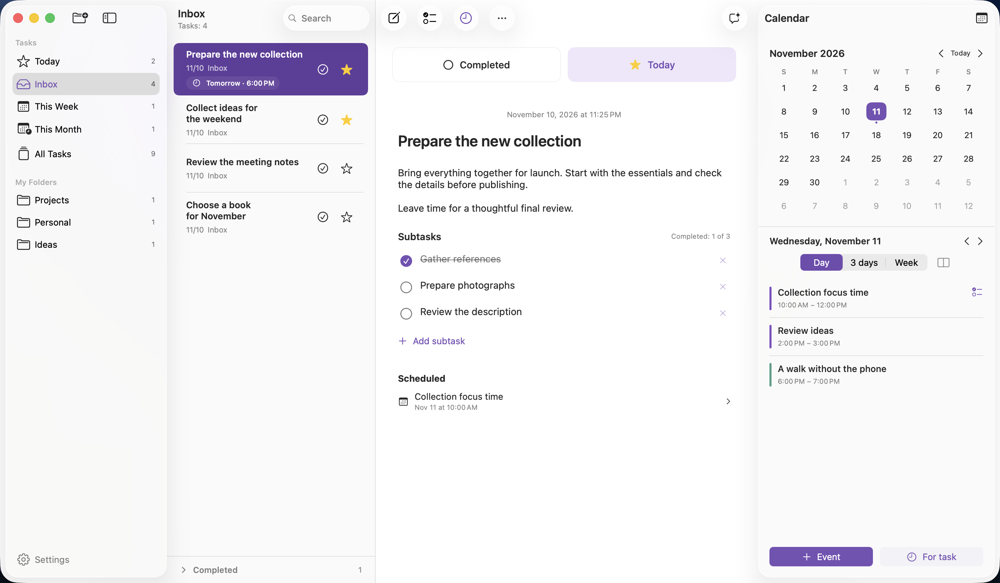
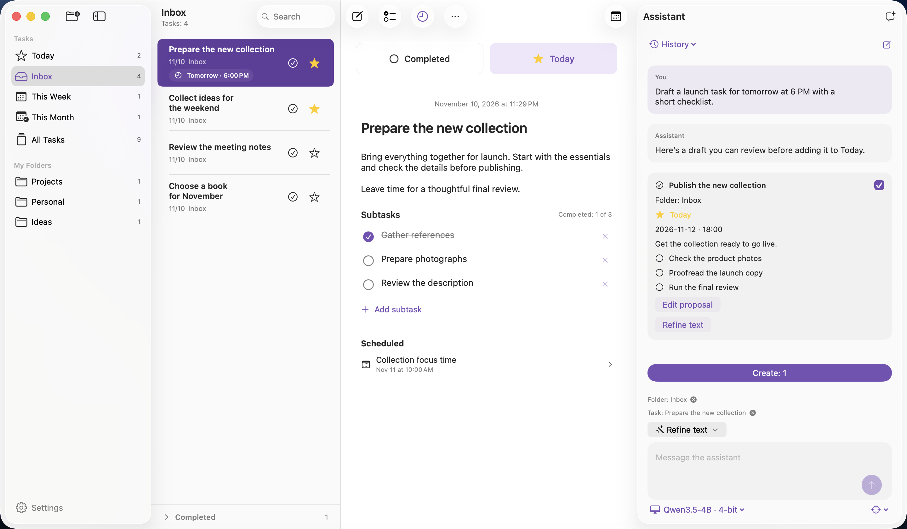
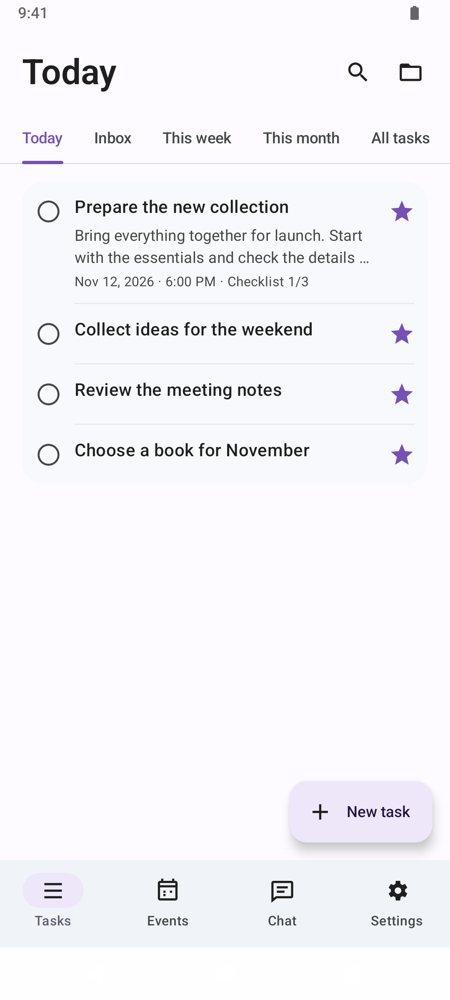
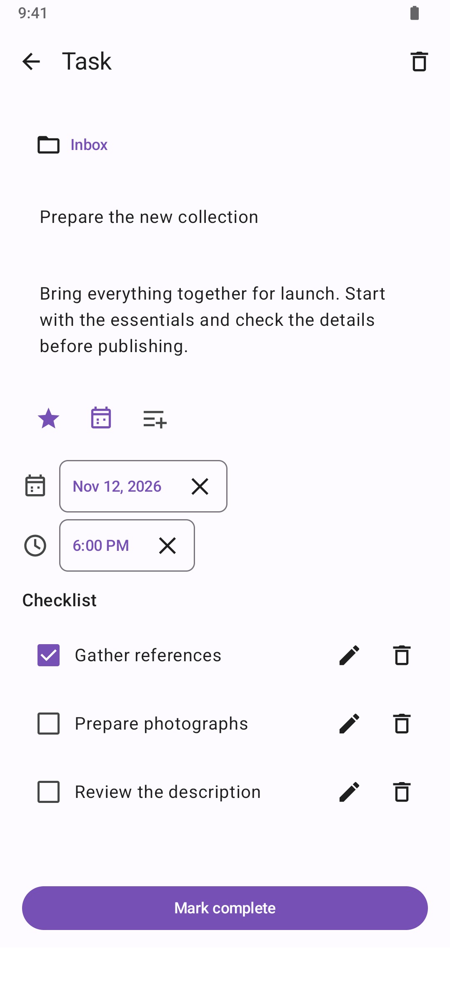
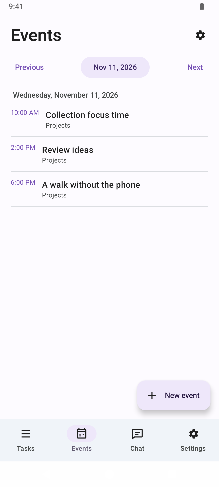
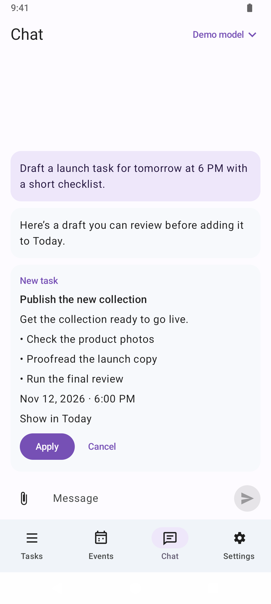

<p align="center">
  
</p>
<h1 align="center">Takt</h1>
<p align="center">Vos tâches, les prochaines étapes et du temps pour les réaliser.</p>
<p align="center"><a href="README.md">English</a> · <a href="README.ru.md">Русский</a> · <a href="README.de.md">Deutsch</a> · <strong>Français</strong></p>

Takt réunit vos tâches, vos priorités du jour et votre calendrier sur macOS et Android. Sur macOS, vous pouvez conserver vos tâches sur votre appareil sans compte. Activez la synchronisation en ligne pour retrouver vos tâches sur Android.



*Capture de l’interface en anglais avec des données fictives.*

## Fonctionnalités

- **Dossiers.** Chaque tâche appartient à un dossier système ou personnalisé. « Today » affiche les tâches marquées d’une étoile. « All Tasks » affiche toutes les tâches par date de création.
- **Déplacement des tâches.** Faites glisser une tâche vers un dossier de la barre latérale ou sélectionnez « Move to Folder » dans le menu contextuel ou le menu « … ». Un glissement vers « Today » ajoute une étoile et conserve le dossier d’origine.
- **Priorités.** Les tâches marquées restent dans « Today » jusqu’au retrait de leur étoile. Leur ordre est conservé.
- **Descriptions et sous-tâches.** Rédigez en texte brut avec continuation automatique des listes et suivez votre progression avec une liste à cocher.
- **Échéances.** Choisissez une date et, si besoin, une heure indépendamment des événements du calendrier. Les notifications suivent les modifications de l’échéance et sont annulées quand la tâche est terminée ou supprimée.
- **Rappel de planification.** Activez « Time to review your tasks » dans les réglages, choisissez une heure et limitez le rappel aux jours ouvrés si besoin. Il est désactivé par défaut.
- **Calendrier latéral.** Une vue mensuelle compacte accompagne un agenda sur un jour, trois jours ou une semaine. L’agenda peut s’afficher verticalement ou horizontalement.
- **Temps réservé aux tâches.** Créez un événement indépendant ou réservez plusieurs créneaux pour une tâche. Modifiez les événements ponctuels accessibles en écriture, déplacez-les et annulez un déplacement.
- **Recherche.** Retrouvez les titres et les descriptions des tâches dans la section ouverte.
- **Interface macOS native.** Thèmes clair et sombre, panneaux translucides, raccourcis clavier et interface en anglais et en russe.

<details>
<summary>Assistant IA sur macOS</summary>



*Conversation fictive et proposition de tâche dans l’interface en anglais.*

</details>

## Installation

**macOS 26 ou ultérieur sur Apple Silicon.**

Version du code source **0.2.17 (build 67)** · [Historique des versions](docs/releases).

Téléchargez un DMG depuis [**Releases**](https://github.com/Alex-De-Vep/takt-planner/releases). Ouvrez-le, faites glisser **Tasks** dans **Applications**, puis éjectez l’image disque. Quittez l’application avant de remplacer une version précédente.

L’application utilise une signature ad hoc. Gatekeeper peut restreindre l’ouverture d’un téléchargement sur un autre Mac. Dans ce cas, vous pouvez compiler l’application dans Xcode.

## Android

Le client fonctionne sur **Android 8.0 ou ultérieur**. Il propose des listes de tâches, des sous-tâches, des rappels d’échéance, un calendrier et un assistant IA. Connectez-vous avec le même compte que celui utilisé pour la synchronisation sur macOS. Après la première synchronisation, Android conserve les modifications hors connexion et les envoie au retour du réseau.

- **Modification des tâches.** Ajoutez une description au besoin et modifiez les éléments de la liste sur un écran dédié. Le champ actif reste visible au-dessus du clavier. Les brouillons de la tâche et des sous-tâches sont enregistrés ensemble lors de la confirmation.
- **Événements du calendrier.** Choisissez un calendrier pour un nouvel événement et ajoutez un lieu ou une description. La suppression d’un événement ponctuel modifiable demande une confirmation. Les événements récurrents et les calendriers en lecture seule peuvent être consultés.
- **Connexions IA.** Changez de modèle ou de fournisseur enregistré dans le chat. ChatGPT et OpenRouter permettent une connexion dans le navigateur. Le certificat racine officiel de GigaChat est inclus pour ses adresses HTTPS.
- **Apparence.** Dans les réglages, choisissez un thème clair, sombre ou système, ainsi que l’anglais, le russe ou la langue de l’appareil.

<p align="center">
  
  
  
  
</p>

*Captures d’Android en anglais avec des données fictives.*

Ouvrez [le projet Android](android/) dans Android Studio ou exécutez `./gradlew :app:assembleDebug` dans `android/` pour créer un APK de test. Le [guide Android](android/README.md) détaille les prérequis, la configuration du compte et l’accès aux calendriers.

## Premiers pas sur macOS

Ouvrez **Help → Planner Help** dans l’application ou lisez le [guide complet en anglais](Packages/PlannerLocalization/Sources/PlannerLocalization/Resources/en.lproj/Help.md).

Appuyez sur **⌘N** pour créer une tâche. Saisissez son titre et appuyez sur **Retour** pour passer à la description. Ajoutez une étoile à la tâche, créez des sous-tâches avec le bouton de liste à cocher ou ouvrez le calendrier depuis le bouton à droite de la barre d’outils.

Une nouvelle tâche est créée dans le dossier ouvert. Depuis « Today », elle est ajoutée à « Inbox » avec une étoile. Depuis « All Tasks », elle est aussi ajoutée à « Inbox ». Les dossiers de la semaine et du mois sont permanents. Un changement de date ne déplace pas les tâches. Le compteur affiche les résultats actifs de la recherche. Le déplacement d’une tâche conserve son contenu, son échéance, ses notifications et ses liens avec le calendrier.

Changer de dossier ferme la tâche sélectionnée et replie les tâches terminées. Sélectionnez une tâche pour l’ouvrir. Une nouvelle tâche ou une tâche ouverte depuis un lien du calendrier ou une notification s’affiche directement. La suppression de la tâche ouverte efface la sélection.

Cliquez sur le texte ou sur la zone libre d’une ligne pour ouvrir la tâche. L’étoile et le bouton de validation agissent indépendamment. Le titre, la description et les sous-tâches restent modifiables après la validation.

L’accès au calendrier est facultatif. Une fois autorisé, l’application utilise les calendriers configurés dans macOS. **Schedule time for task** crée un événement lié à la tâche sélectionnée.

Configurez les rappels dans **⌘, → Notifications**. Pour une échéance avec une heure, la notification est prévue à cette heure. Pour une échéance sans heure, elle utilise l’heure choisie dans les réglages, 09:00 par défaut. macOS demande l’autorisation à la première échéance ou à l’activation explicite des notifications. **Test notification** programme un message dans cinq secondes. macOS peut envoyer les notifications prévues lorsque l’application est fermée.

Les événements du calendrier acceptent plusieurs alertes relatives ou à une date précise. Vous pouvez modifier ou supprimer une alerte en conservant les autres. Le calendrier système envoie ces alertes.

Dans les réglages, **Account** regroupe le compte et la langue, **Notifications** les rappels, **Calendar** les calendriers visibles et le calendrier par défaut, et **Assistant** les options de l’assistant IA. [Réglages et notifications](docs/settings.md#english).

| Raccourci | Action |
| --- | --- |
| ⌘N | Nouvelle tâche |
| ⇧⌘N | Nouveau dossier |
| ⌘Retour | Marquer une tâche comme terminée ou la rouvrir |
| Delete | Supprimer la tâche sélectionnée lorsque la liste est active |
| ⌘, | Réglages |

## Confidentialité et limites actuelles

Vos tâches restent accessibles sur votre appareil. Si vous activez la synchronisation en ligne, le serveur synchronise votre bibliothèque. L’application ne contient ni publicité ni SDK d’analyse. Les événements sont stockés dans le calendrier système et peuvent être synchronisés par le fournisseur que vous utilisez. [Informations sur la confidentialité](docs/privacy.md).

- La synchronisation en ligne nécessite un compte. Sur Mac, le stockage local fonctionne sans compte.
- Les descriptions sont en texte brut. Le gras et l’italique ne sont pas pris en charge.
- Les événements récurrents, les exceptions et les calendriers en lecture seule sont consultables.
- La suppression d’une tâche conserve les événements qui lui sont liés. La planification dans le calendrier et la validation de la tâche sont indépendantes.
- L’application transmet les échéances futures à macOS. Si la file d’attente est limitée, les échéances les plus proches et les rappels récurrents sont prioritaires. La file se remplit au lancement, à la réactivation de l’application et à la modification d’une tâche. Les autorisations de macOS et le mode Concentration contrôlent l’affichage des bannières.
- L’application évolue. Sauvegardez votre système avant de l’utiliser pour des données importantes.

## Compiler depuis les sources

Prérequis pour macOS : macOS 26+, Xcode 26 avec Swift 6.2 et les Command Line Tools. Les scripts nécessitent Python 3. Le paquet de traduction est inclus. La compilation utilise des versions fixes des paquets Swift MLX.

Ouvrez `Planner.xcodeproj`, sélectionnez **Planner → My Mac** et lancez l’application avec **⌘R**.

Compiler l’application et les sources des tests :

```sh
xcodebuild -project Planner.xcodeproj -scheme Planner \
  -configuration Debug -destination 'generic/platform=macOS' \
  -derivedDataPath .build/DerivedData build-for-testing
```

Créer un DMG de distribution pour Apple Silicon :

```sh
python3 scripts/build_release.py
```

Les fichiers sont écrits dans `dist/`. [Guide de développement](docs/development.md) · [Guide de publication](docs/releasing.md).

## Contribuer

Les rapports de bugs et les suggestions sont les bienvenus dans [**Issues**](https://github.com/Alex-De-Vep/takt-planner/issues). Lisez [CONTRIBUTING.md](CONTRIBUTING.md) avant de contribuer. Utilisez des données fictives dans les rapports et gardez vos identifiants et vos clés de signature privés.

Les notes de version indiquent les tests qui ont été exécutés.

## Licence

Takt est distribué sous la [licence Apache 2.0](LICENSE). Les mentions d’attribution figurent dans [NOTICE](NOTICE).

Créé par [Alex-De-Vep](https://github.com/Alex-De-Vep).
